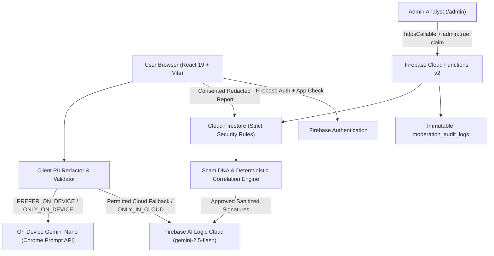

# ScamSignal

> **Detect individually. Protect collectively.**

ScamSignal is a privacy-first, hybrid-AI scam triage and collective threat intelligence platform built with React 19, TypeScript, Vite, Tailwind CSS, Firebase, and Firebase AI Logic.

---

## The Problem

Everyday users receive suspicious SMS messages, WhatsApp lures, phishing emails, fake job offers, and fraudulent payment requests containing sensitive personal data (phone numbers, bank/UPI identifiers, OTPs, and addresses). Traditional cloud-only analyzers force users to choose between privacy and protection, while community threat feeds often suffer from unmoderated accusations, PII leaks, or hallucinated campaign links.

ScamSignal solves this by performing **client-side PII redaction and local-first AI triage** via **Firebase AI Logic** (Gemini Nano on-device when supported), while restricting shared community intelligence to **explicitly consented, redacted signatures**, **deterministic campaign correlation**, and **server-verified moderation**.

---

## Key Features

- **Private Analyzer (`/`)**: Paste suspicious SMS, WhatsApp, email, job offers, or payment requests. Scrubs PII client-side, runs Firebase AI Logic (`PREFER_ON_DEVICE`), validates structured Zod outputs, and displays the actual runtime `inferenceSource` (`on_device`, `in_cloud`, or `unknown`).
- **Privacy-First Redaction & Reporting**: Detects and scrubs phone numbers, emails, UPI IDs, account numbers, OTPs, URLs, and addresses before allowing optional community submission with an interactive preview and consent gate.
- **Scam DNA & Deterministic Campaign Correlation (`/campaigns`, `/campaigns/:campaignId`)**: Converts sanitized reports into normalized Scam DNA signatures, correlates reports using transparent weighted evidence rules (ignoring generic words like `"urgent"` or `"payment"`), and visualizes explainable links.
- **Collective Campaign Analysis (`ONLY_IN_CLOUD`)**: Summarizes shared indicators, inconsistencies, and evidence to review across approved, sanitized signatures—never inventing unsupported relationships.
- **Community Feed (`/feed`) & Corroboration**: Cursor-paginated public threat reports with filtering, sorting, encounter confirmations, and dispute reporting (capped at 1 per user per campaign).
- **Intelligence Dashboard (`/dashboard`) & Scam Radar (`/radar`)**: Real-time Firestore metrics, category distribution, safety alerts, and isolated demonstration preview mode.
- **Safety Action Assistant (`/safety`)**: Grounded guidance for verifying job offers, checking official contacts, phishing response, credential compromise, and financial fraud (including India's `cybercrime.gov.in` and helpline `1930`).
- **Alerts Center (`/alerts`)**: Follow selected scam categories and track read/unread high-signal warnings.
- **Administrative Moderation Console (`/admin`)**: Server-side Cloud Functions enforcing `request.auth.token.admin === true` custom claims with immutable `moderation_audit_logs`.

---

## Architecture



---

## Hybrid Inference Design (Local vs. Cloud)

ScamSignal uses the official `firebase/ai` Web SDK (`InferenceMode`) and captures `response.inferenceSource` truthfully on every call:

| Mode | Purpose | Execution Path | Data Sent |
| :--- | :--- | :--- | :--- |
| `PREFER_ON_DEVICE` | Private message analyzer & Safety Assistant | Attempts local Gemini Nano first; falls back to `gemini-2.5-flash` if unavailable | Client-redacted text |
| `ONLY_ON_DEVICE` | Strict local-only triage | Runs exclusively on-device; fails cleanly if browser/model is unavailable | Never leaves device |
| `ONLY_IN_CLOUD` | Collective campaign analysis & Scam DNA interpretation | Runs in cloud `gemini-2.5-flash` with strict JSON `Schema` | Approved, sanitized signatures only (zero raw messages) |

---

## Firebase Setup

1. Create a Firebase project in the [Firebase Console](https://console.firebase.google.com/).
2. Enable **Authentication** (Email/Password; optionally Google Sign-In if setting `VITE_FIREBASE_ENABLE_GOOGLE_AUTH=true`).
3. Create a **Cloud Firestore** database and deploy `firestore.rules`.
4. Enable **Firebase AI Logic** API in the Firebase Console.
5. Enable **App Check** with **reCAPTCHA v3** for your web app (recommended for production).
6. *(Optional for `/admin`)* Deploy `functions/` and assign `{ admin: true }` custom claims via the Firebase Admin SDK—never via Firestore user documents.

---

## Environment Variables

Copy `.env.example` to `.env` and populate values from **Firebase Console → Project Settings**:

```env
VITE_FIREBASE_API_KEY=
VITE_FIREBASE_AUTH_DOMAIN=
VITE_FIREBASE_PROJECT_ID=
VITE_FIREBASE_STORAGE_BUCKET=
VITE_FIREBASE_MESSAGING_SENDER_ID=
VITE_FIREBASE_APP_ID=
VITE_FIREBASE_APP_CHECK_SITE_KEY=
VITE_FIREBASE_APP_CHECK_DEBUG_TOKEN=
VITE_FIREBASE_ENABLE_GOOGLE_AUTH=false
```

Never commit `.env` or real credentials to source control. When `.env` is unconfigured, ScamSignal remains navigable and displays clear setup notices instead of simulating auth or database operations.

---

## Installation & Local Development

### Prerequisites
- Node.js `>= 20`
- npm `>= 10`

### Commands

```bash
# Install dependencies
npm install

# Start Vite dev server
npm run dev

# Run TypeScript typechecking
npm run typecheck

# Run Vitest unit & audit test suite
npm run test

# Build production bundle
npm run build
```

---

## Deployment (Firebase Hosting, Rules & Functions)

```bash
# 1. Build the production frontend
npm run build

# 2. Deploy Firestore security rules and Hosting
firebase deploy --only firestore:rules,hosting

# 3. (Optional) Build and deploy Cloud Functions for admin moderation
cd functions && npm install && npm run build && cd ..
firebase deploy --only functions
```

---

## Privacy & Known Limitations

- **Client-Side Redaction**: Regex-based PII scrubbing (`redactPII`) catches standard phones, emails, UPI handles, cards/accounts, OTPs, URLs, and addresses, but may miss unusual unstructured names. Users must always review the `RedactionPreviewModal` before submitting.
- **Advisory AI Outputs**: Threat classifications, Scam DNA inferences, and Safety Assistant steps are advisory pattern recognitions—never guaranteed legal/financial findings or payment recovery promises.
- **On-Device Model Availability**: Local inference requires a browser supporting the Chrome Prompt API / Gemini Nano (`ONLY_ON_DEVICE` surfaces clear `UNSUPPORTED_BROWSER` or `LOCAL_MODEL_UNAVAILABLE` states otherwise).
- **Test Coverage Scope**: Automated unit tests (`vitest`) run against mocked Firebase SDKs; live Firestore rules, Cloud Functions execution, and on-device Gemini Nano require verification against a configured Firebase project or Emulator Suite.

---

## License

Licensed under the **Apache License, Version 2.0**. See [LICENSE](./LICENSE) for details.
