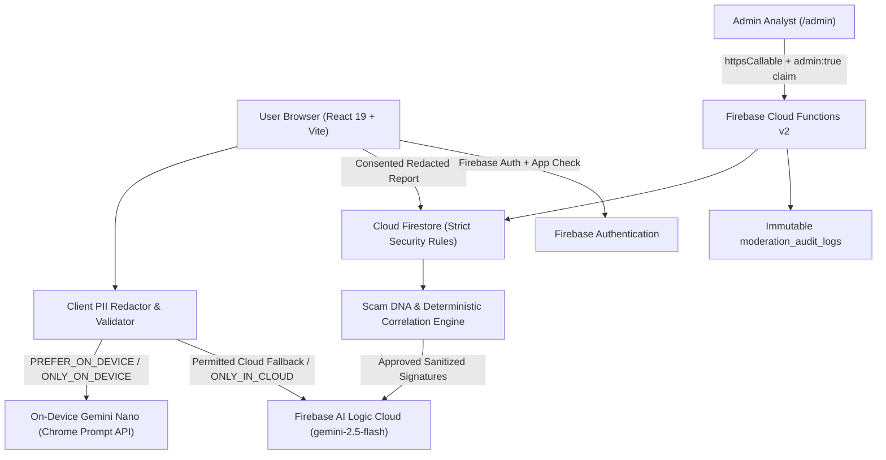
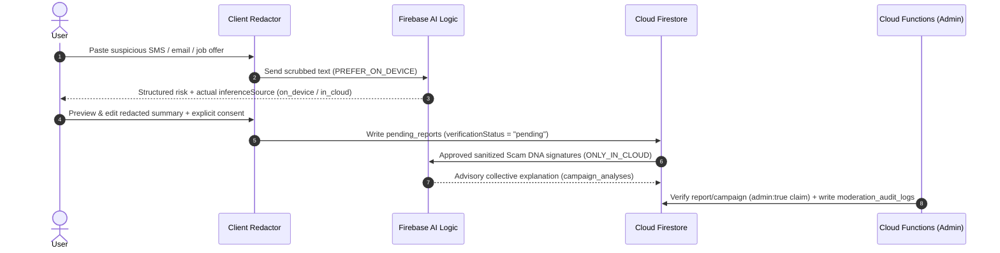

# ScamSignal

> **Detect individually. Protect collectively.**

ScamSignal is a privacy-first, hybrid-AI scam triage and collective threat intelligence platform built with **React 19**, **TypeScript**, **Vite**, **Tailwind CSS**, **Firebase**, and **Firebase AI Logic**.

---

## The Problem

Everyday users receive suspicious SMS messages, WhatsApp lures, phishing emails, fake job offers, and fraudulent payment requests containing sensitive personal data (phone numbers, bank/UPI identifiers, OTPs, and addresses). Cloud-only analyzers force users to upload private messages to remote servers, while informal community channels spread unverified accusations, expose victims' personal data, or invent false campaign links.

ScamSignal solves this by performing **client-side PII redaction and local-first AI triage** via **Firebase AI Logic** (Gemini Nano on-device when supported), while restricting shared community intelligence to **explicitly consented, redacted observations**, **deterministic campaign correlation**, and **server-verified moderation**.

---

## Technology Stack

| Layer | Technologies | Purpose |
| :--- | :--- | :--- |
| **Frontend UI** | React 19, TypeScript 5.8, Vite 6, React Router 7 | Responsive SPA with light Firebase-inspired theme & keyboard accessibility |
| **Styling & Icons** | Tailwind CSS 3.4, `lucide-react`, `clsx`, `tailwind-merge` | Consistent design tokens, loading skeletons, and high-contrast components |
| **Validation & Redaction** | Zod 4, Custom Regex PII Redactor (`redactPII`) | Strict AI JSON schema validation & client-side PII scrubbing |
| **Hybrid AI Runtime** | Firebase AI Logic Web SDK (`firebase/ai` v13.4) | `PREFER_ON_DEVICE`, `ONLY_ON_DEVICE`, `ONLY_IN_CLOUD` with runtime `inferenceSource` |
| **Backend & Security** | Firebase Auth, Cloud Firestore, App Check, Cloud Functions v2 | Owner-scoped rules, composite indexes, and `admin: true` claim moderation |
| **Testing & Quality** | Vitest 5, `tsc --noEmit` (`strict: true`) | 31 unit/security/E2E audit test suites & production build validation |

---

## System Architecture



### Privacy-First Triage & Collective Intelligence Flow



---

## Core Features

| Route | Feature | Description |
| :--- | :--- | :--- |
| `/` | **Private Analyzer** | Scrubs PII client-side (`redactPII`), runs `PREFER_ON_DEVICE` Firebase AI Logic inference, and displays the actual runtime `inferenceSource` (`on_device`, `in_cloud`, or `unknown`). |
| `/dashboard` | **Intelligence Dashboard** | Live Firestore metrics, recent reports, emerging potential campaigns, category distribution chart, safety alerts, and recent community activity. |
| `/radar` | **Scam Radar** | Discovery view for emerging scam categories, manipulation patterns, and warnings, with isolated demonstration preview mode. |
| `/feed` | **Community Reports** | Cursor-paginated, filterable directory of sanitized public reports clearly distinguishing **Unverified User Reports** from **Verified Warnings**. |
| `/campaigns` | **Campaign Intelligence** | Deterministic Scam DNA correlation (`shared_domain`, tokenized payment/contact handles, impersonated orgs, specific phrases) with interactive relationship graphs and `ONLY_IN_CLOUD` collective summaries. |
| `/safety` | **Safety Action Assistant** | Grounded incident response guidance for job offers, phishing, credential leaks, and financial fraud (including India's `cybercrime.gov.in` and helpline `1930`). |
| `/alerts` | **Notification Center** | Follow selected scam categories and track read/unread high-signal warnings. |
| `/admin` | **Moderation Console** | Server-verified (`admin: true` custom claims via Cloud Functions v2) triage queue, campaign link review, and immutable `moderation_audit_logs`. |
| `/profile` & `/auth` | **Account & Settings** | Firebase Auth persistence, display name, default inference mode, and default report visibility. |
| `/privacy` | **Privacy Architecture** | Transparent breakdown of client redaction, zero raw storage, and advisory boundaries. |

---

## Hybrid Inference Design (Local vs. Cloud)

ScamSignal uses the official `firebase/ai` Web SDK (`InferenceMode`) and captures `response.inferenceSource` truthfully on every call:

| Mode | Purpose | Execution Path | Data Sent |
| :--- | :--- | :--- | :--- |
| `PREFER_ON_DEVICE` | Private message analyzer & Safety Assistant | Attempts local Gemini Nano first; falls back to `gemini-2.5-flash` if unavailable | Client-redacted text |
| `ONLY_ON_DEVICE` | Strict local-only triage | Runs exclusively on-device; fails cleanly if browser/model is unavailable | Never leaves device |
| `ONLY_IN_CLOUD` | Collective campaign analysis & Scam DNA interpretation | Runs in cloud `gemini-2.5-flash` with strict JSON `Schema` | Approved, sanitized signatures only (zero raw messages) |

---

## Firestore Data Model & Security Boundaries

| Collection | Access Control (`firestore.rules`) | Purpose |
| :--- | :--- | :--- |
| `pending_reports` | `get`/`list` public only when `visibility == 'community_public'`; `create` requires `verificationStatus == 'pending'` & server timestamp; `update` admin-only | User-consented redacted scam observations |
| `campaigns` | Public read; write admin-only | Correlated scam campaigns (`MONITORING`, `ACTIVE_WAVE`, `CONTAINED`) |
| `report_campaign_links` | Public read; write admin-only | Deterministic links with `supportingIndicators` & `correlationScore` |
| `campaign_analyses` | Public read; write admin-only | Advisory `ONLY_IN_CLOUD` collective campaign explanations |
| `campaign_confirmations` | Authenticated read; 1 create per user (`campaignId_uid`); no updates | Community encounter confirmations |
| `campaign_disputes` | Authenticated read; 1 create per user (`campaignId_uid`); update admin-only | Community connection disputes |
| `users/{uid}` | Owner read/write; blocks `isAdmin`, `role`, `admin` keys | Minimal user preferences (`followedCategories`, defaults) |
| `users/{uid}/alert_states` | Owner read/write | Per-user notification read/unread states |
| `moderation_audit_logs` | Admin read; `write: if false` (Admin SDK / Cloud Functions only) | Immutable audit trail of all admin moderation actions |

---

## Project Structure

```text
src/
├── components/       # Reusable UI, layout, auth, scam, campaign, and dashboard components
├── context/          # AuthContext & user profile state
├── features/         # Route views (analyzer, dashboard, radar, feed, campaigns, safety, alerts, admin, auth, profile, privacy)
├── hooks/            # Custom hooks (useScamAnalyzer, useCommunityFeed)
├── services/
│   ├── ai/           # Firebase AI Logic integration & Zod response schemas
│   ├── campaigns/    # Deterministic correlation engine & ONLY_IN_CLOUD collective analysis
│   ├── dna/          # Scam DNA extraction & normalization
│   ├── firebase/     # Firebase app, Auth, Functions, and App Check initialization
│   ├── firestore/    # Typed converters, reports, campaigns, corroboration, alerts, dashboard, admin
│   └── safety/       # Grounded Safety Action Assistant playbooks
├── utils/            # Client-side PII redactor, input validators, & safe Firestore error formatter
functions/            # Firebase Cloud Functions v2 for server-verified admin moderation & audit logs
tests/unit/           # Vitest unit, security rules, and failure-mode audit suites
```

---

## Local Setup & Development

### Prerequisites
- Node.js `>= 20`
- npm `>= 10`
- A Firebase project in the [Firebase Console](https://console.firebase.google.com/)

### 1. Install Dependencies
```bash
npm install
```

### 2. Configure Firebase Services
In the [Firebase Console](https://console.firebase.google.com/):
1. **Authentication** → Enable **Email/Password** (and optionally **Google** or **Anonymous**).
2. **Firestore Database** → Create a database in Production mode.
3. **Firebase AI Logic** → Enable the Gemini Developer API.
4. *(Optional)* **App Check** → Register your web app with reCAPTCHA v3.

### 3. Configure Environment Variables
Copy `.env.example` to `.env` (never commit `.env`):
```env
VITE_FIREBASE_API_KEY=
VITE_FIREBASE_AUTH_DOMAIN=
VITE_FIREBASE_PROJECT_ID=
VITE_FIREBASE_STORAGE_BUCKET=
VITE_FIREBASE_MESSAGING_SENDER_ID=
VITE_FIREBASE_APP_ID=
VITE_FIREBASE_APP_CHECK_SITE_KEY=
VITE_FIREBASE_APP_CHECK_DEBUG_TOKEN=
VITE_FIREBASE_ENABLE_GOOGLE_AUTH=false
```

### 4. Deploy Firestore Rules & Composite Indexes
```bash
npx firebase-tools login
npx firebase-tools use --add
npx firebase-tools deploy --only firestore:rules,firestore:indexes
```

### 5. Run Locally
```bash
npm run dev        # Start Vite dev server
npm run typecheck  # Run TypeScript compiler checks
npm run test       # Run Vitest unit & audit suite
npm run build      # Build production bundle
```

---

## Deployment

### Option A: Deploy Frontend to Vercel (Recommended)
1. Push your repository to GitHub (`git push origin main`).
2. Import the repository at [vercel.com](https://vercel.com/) (`Framework: Vite`, `Build Command: npm run build`, `Output Directory: dist`). [vercel.json](./vercel.json) is included for SPA routing.
3. Add all `VITE_FIREBASE_*` environment variables in **Vercel → Project Settings → Environment Variables** and deploy.
4. In **Firebase Console → Authentication → Settings → Authorized domains**, add your `*.vercel.app` domain.

### Option B: Deploy Frontend to Firebase Hosting
```bash
npm run build
npx firebase-tools deploy --only hosting
```

### Cloud Functions (`/admin` Moderation)
```bash
cd functions && npm install && npm run build && cd ..
npx firebase-tools deploy --only functions
```
Assign `{ admin: true }` custom claims strictly via the Firebase Admin SDK—never via user-editable Firestore fields.

---

## Privacy & Known Limitations

- **Client-Side Redaction**: `redactPII` catches standard phones, emails, UPI handles, cards/accounts, OTPs, URLs, and addresses, but may miss unusual unstructured names. Users must review `RedactionPreviewModal` before submitting.
- **Advisory AI Outputs**: Risk levels, Scam DNA inferences, and Safety Assistant guidance are advisory pattern recognitions—never legal/financial findings or payment recovery promises.
- **On-Device Model Availability**: `ONLY_ON_DEVICE` requires a browser supporting the Chrome Prompt API / Gemini Nano and surfaces clear `UNSUPPORTED_BROWSER` or `LOCAL_MODEL_UNAVAILABLE` states otherwise.
- **Automated Test Scope**: Vitest unit tests run with mocked Firebase SDKs; live Firestore rules, Cloud Functions, and on-device Gemini Nano require testing against a real Firebase project or Emulator Suite.

---

## License

Licensed under the **Apache License, Version 2.0**. See [LICENSE](./LICENSE) for details.
