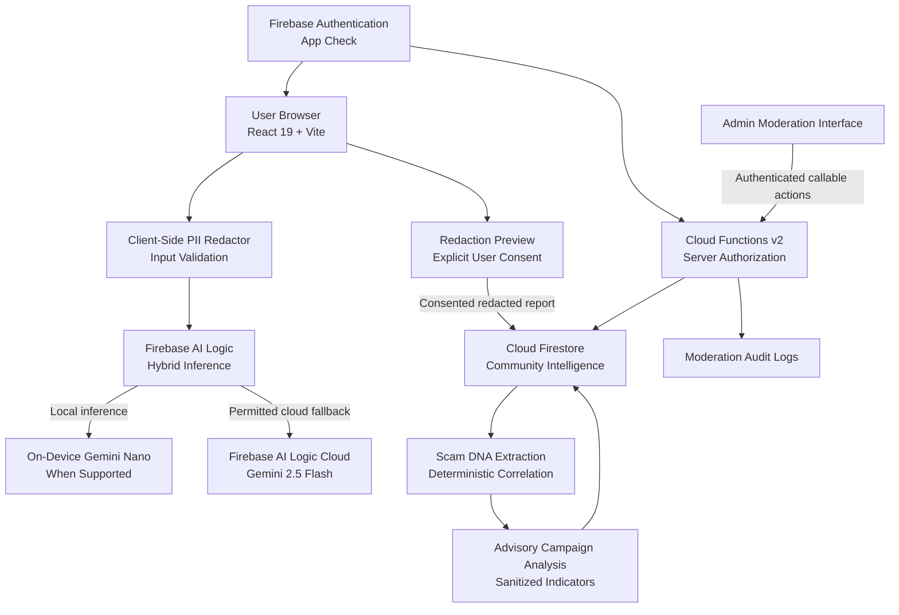
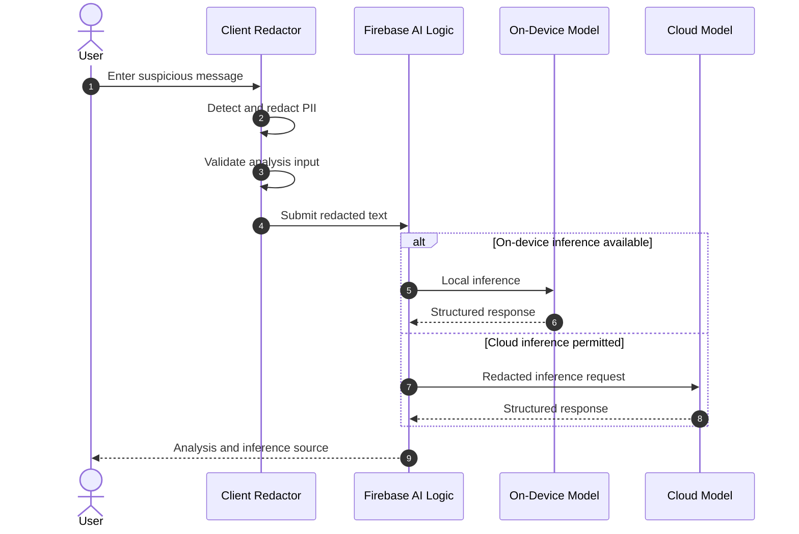
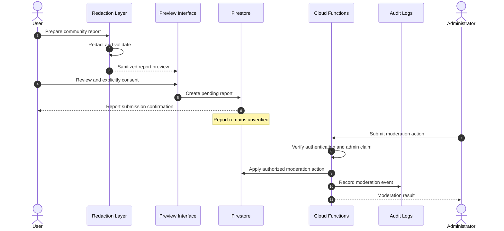
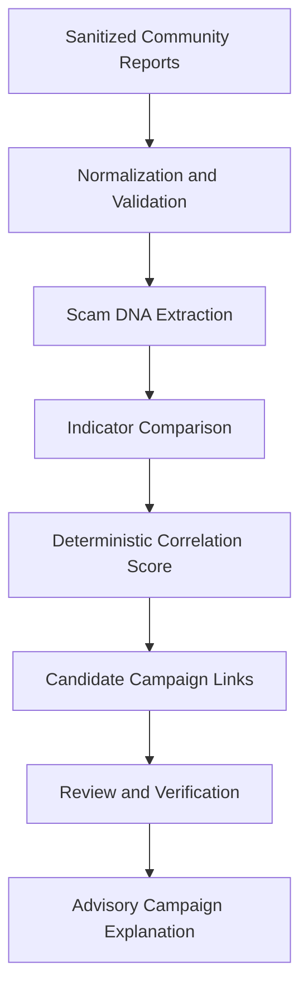

# ScamSignal

### Detect Individually. Protect Collectively.

**ScamSignal is a privacy-first, hybrid-AI scam intelligence platform designed to help people identify suspicious messages, understand potential threats, and contribute to safer digital communities.**

It combines client-side privacy protection, on-device AI inference where supported, controlled cloud analysis, deterministic scam campaign correlation, and server-verified community moderation.

ScamSignal is built around a simple principle:

> Personal messages should remain private. Shared intelligence should remain trustworthy.

---

<p align="center">
  
  
  
  
  
  
  
</p>

---

## Table of Contents

- [Overview](#overview)
- [Why ScamSignal?](#why-scamsignal)
- [Core Principles](#core-principles)
- [Key Features](#key-features)
- [System Architecture](#system-architecture)
- [Privacy Architecture](#privacy-architecture)
- [Hybrid AI Inference](#hybrid-ai-inference)
- [Scam DNA and Campaign Correlation](#scam-dna-and-campaign-correlation)
- [Community Intelligence Lifecycle](#community-intelligence-lifecycle)
- [Technology Stack](#technology-stack)
- [Application Routes](#application-routes)
- [Data Model and Security Boundaries](#data-model-and-security-boundaries)
- [Threat Model](#threat-model)
- [Project Structure](#project-structure)
- [Getting Started](#getting-started)
- [Environment Configuration](#environment-configuration)
- [Development Workflow](#development-workflow)
- [Testing and Quality Assurance](#testing-and-quality-assurance)
- [Deployment](#deployment)
- [Security and Responsible Disclosure](#security-and-responsible-disclosure)
- [Privacy and Limitations](#privacy-and-limitations)
- [Roadmap](#roadmap)
- [Contributing](#contributing)
- [License](#license)

---

## Overview

Digital scams are increasingly sophisticated, personalized, and difficult to distinguish from legitimate communication.

Fraudulent messages may arrive through:

- SMS and messaging applications
- WhatsApp and other social platforms
- Phishing emails
- Fake recruitment and employment offers
- Impersonation campaigns
- Fraudulent payment requests
- Malicious websites and shortened URLs
- Social engineering and urgency-based manipulation

Traditional cloud-only analysis systems can require users to upload entire messages, potentially exposing phone numbers, financial identifiers, authentication codes, addresses, and other sensitive information.

At the same time, informal scam-reporting communities often struggle with unreliable claims, duplicated reports, unverified campaign relationships, and the accidental publication of victim information.

ScamSignal addresses these challenges through a privacy-conscious, hybrid architecture.

### The ScamSignal approach

1. **Analyze privately** — Process suspicious messages through client-side redaction and hybrid AI inference.
2. **Understand the risk** — Identify suspicious indicators, manipulation techniques, and potential scam patterns.
3. **Share selectively** — Allow users to contribute explicitly consented, redacted observations.
4. **Correlate deterministically** — Connect reports using reproducible scam indicators rather than unsupported AI-generated relationships.
5. **Verify centrally** — Use server-authorized moderation to distinguish community observations from verified warnings.
6. **Protect collectively** — Convert privacy-preserving observations into actionable community intelligence.

ScamSignal is designed to make scam awareness more accessible without treating personal data as the price of security.

---

## Why ScamSignal?

| Challenge | ScamSignal Approach |
|---|---|
| Sensitive messages sent to cloud analyzers | Client-side PII redaction before permitted AI requests |
| Dependence on cloud inference | On-device inference when supported |
| Unclear AI execution location | Runtime inference-source reporting |
| Unverified scam accusations | Explicit verification states and moderation |
| Duplicate or unrelated campaign reports | Deterministic indicator-based correlation |
| Victim information exposed in community reports | Redacted, consent-based submissions |
| User-generated administrator privileges | Server-verified Firebase custom claims |
| AI-generated false campaign links | Deterministic correlation separated from advisory AI analysis |
| Unsafe or misleading incident guidance | Grounded safety playbooks with clear advisory boundaries |

---

## Core Principles

### 1. Privacy by Design

Raw suspicious messages are processed locally before AI analysis.

The application uses a client-side redaction layer to identify and replace common personally identifiable information (PII), including:

- Phone numbers
- Email addresses
- UPI identifiers
- Payment and account identifiers
- OTP-like authentication codes
- URLs
- Address patterns

Redaction is a privacy safeguard, not a guarantee of complete anonymization.

### 2. Local-First Intelligence

ScamSignal prefers on-device inference when the browser and model environment support it.

Cloud inference is governed by the selected inference mode and receives only client-redacted content for the private analyzer.

### 3. Explicit Consent

Community intelligence is opt-in.

Users review the redacted information before submitting a report. The platform does not treat private analysis as automatic permission to publish an observation.

### 4. Deterministic Correlation

Campaign relationships are established through reproducible indicators such as shared domains, normalized contact or payment handles, impersonated organizations, and distinctive phrases.

AI may explain correlated patterns, but it does not independently establish campaign relationships.

### 5. Verified Moderation

Administrative actions are authorized through Firebase Authentication custom claims and trusted Cloud Functions.

Client-side role fields and user-editable profile data are never accepted as authoritative administrator credentials.

### 6. Transparent AI

ScamSignal distinguishes between:

- AI-assisted risk assessments
- Deterministically correlated indicators
- Community-submitted observations
- Server-verified warnings

This separation is essential for maintaining trust in security intelligence.

---

## Key Features

### Private Scam Analyzer

The primary analysis interface allows users to inspect suspicious messages without immediately sharing them with the community.

Capabilities include:

- Client-side PII redaction
- Structured AI scam analysis
- Risk-level assessment
- Suspicious indicator extraction
- Explanation of manipulation patterns
- Runtime inference-source reporting
- Local-only inference mode
- Clear unsupported-browser and unavailable-model states

### Intelligence Dashboard

A consolidated overview of community scam intelligence.

Includes:

- Live Firestore metrics
- Recent community reports
- Emerging potential campaigns
- Scam category distribution
- Safety alerts
- Recent community activity

### Scam Radar

A discovery interface for understanding emerging scam patterns.

Includes:

- Scam category exploration
- Manipulation-pattern awareness
- Potential campaign signals
- Threat discovery
- Isolated demonstration preview mode

Demonstration data is kept separate from live community intelligence.

### Community Reports

A searchable and filterable directory of sanitized community observations.

Features:

- Cursor-based pagination
- Category filtering
- Report discovery
- Sanitized report summaries
- Clear verification labels
- Distinction between unverified reports and verified warnings

### Campaign Intelligence

A campaign analysis interface powered by deterministic Scam DNA correlation.

Features:

- Shared-indicator discovery
- Campaign relationship visualization
- Correlation evidence inspection
- Supporting indicator summaries
- Community confirmations
- Campaign disputes
- Advisory collective analysis

### Safety Action Assistant

An incident-response assistant designed to provide practical next steps.

Guidance covers:

- Suspicious job offers
- Phishing and impersonation
- Credential exposure
- Financial fraud
- Suspicious payment requests
- Account compromise

For India-specific incidents, the assistant includes relevant official reporting resources, such as the National Cyber Crime Reporting Portal and cybercrime helpline 1930.

### Notification Center

A personalized notification interface for tracking relevant scam intelligence.

Includes:

- Followed scam categories
- High-signal warnings
- Read and unread states
- User-specific alert preferences

### Moderation Console

A restricted administrative interface for maintaining the integrity of community intelligence.

Features:

- Pending report review
- Campaign relationship review
- Verification and moderation actions
- Server-side authorization
- Immutable moderation audit records

### Account and Privacy Settings

User preferences and account management include:

- Firebase Authentication
- Display-name management
- Inference-mode preferences
- Default report visibility
- Followed categories
- Privacy architecture transparency

---

## System Architecture

ScamSignal uses a client-first analysis pipeline and a server-controlled community intelligence lifecycle.



### Architectural boundaries

| Component | Responsibility |
|---|---|
| React application | User interface, interaction, and client-side workflows |
| PII redactor | Local privacy transformation before permitted AI requests |
| Firebase AI Logic | Hybrid inference orchestration |
| Firestore | Persisted community intelligence and application state |
| Scam DNA engine | Deterministic indicator extraction and correlation |
| Cloud Functions | Trusted moderation and privileged server operations |
| Firebase Auth | User identity and administrator authentication |
| App Check | Application-origin and abuse-protection signals |
| Audit logs | Traceability of privileged moderation operations |

---

## Privacy Architecture

Privacy is enforced through explicit data-flow boundaries.

### Private Analysis Lifecycle



### Community Reporting Lifecycle



### Privacy Guarantees and Boundaries

ScamSignal is designed to:

- Redact common PII patterns before private AI analysis.
- Avoid intentionally storing raw private messages in community report documents.
- Require explicit user consent before community submission.
- Store only sanitized, approved campaign indicators for collective analysis.
- Separate private analysis from public reporting.
- Restrict privileged moderation operations to trusted server execution.

**Important:** Client-side redaction cannot guarantee that every sensitive detail will be detected. Users must review the redaction preview before sharing information.

---

## Hybrid AI Inference

ScamSignal integrates the Firebase AI Logic Web SDK using its supported inference modes.

The application records the actual runtime inference source returned by the SDK rather than assuming that a requested mode determines where execution occurred.

### Supported Inference Modes

| Mode | Intended Use | Execution | Data Boundary |
|---|---|---|---|
| `PREFER_ON_DEVICE` | Private analyzer and safety assistant | Prefer local inference; permitted cloud fallback | Client-redacted text |
| `ONLY_ON_DEVICE` | Strict local-only analysis | On-device only | No inference request leaves the device |
| `ONLY_IN_CLOUD` | Collective campaign interpretation | Cloud inference | Approved sanitized signatures only |

### Runtime Transparency

Every AI response should preserve the actual inference-source metadata:

```ts
response.inferenceSource
```

The application exposes the resulting source through the interface:

- `on_device`
- `in_cloud`
- `unknown`

This provides users with a more accurate understanding of how their analysis was processed.

### Structured AI Responses

AI responses are validated using Zod schemas before being consumed by the application.

The validation layer is responsible for:

- Enforcing expected response structure
- Rejecting malformed output
- Applying safe defaults where appropriate
- Preventing unvalidated model output from entering critical workflows

AI-generated assessments remain advisory and are not treated as authoritative fraud determinations.

---

## Scam DNA and Campaign Correlation

ScamSignal uses a deterministic correlation engine to identify potentially related scam observations.

### Correlation Indicators

The engine evaluates normalized indicators such as:

- Shared domains
- Tokenized payment identifiers
- Contact handles
- Impersonated organizations
- Distinctive message phrases
- Repeated scam signatures

### Correlation Model



### Deterministic vs. Advisory Intelligence

ScamSignal deliberately separates two responsibilities.

**Deterministic correlation**

- Identifies shared indicators.
- Produces reproducible relationships.
- Records supporting evidence.
- Enables review and dispute.

**AI-assisted interpretation**

- Summarizes approved campaign signatures.
- Explains possible patterns.
- Generates advisory collective analysis.
- Does not independently create authoritative campaign links.

This separation reduces the risk of unsupported AI-generated accusations and makes campaign intelligence easier to audit.

---

## Community Intelligence Lifecycle

Community intelligence is designed around trust, consent, and verification.

### Report States

| State | Meaning |
|---|---|
| Pending | Submitted observation awaiting moderation |
| Unverified | Community report not yet confirmed |
| Verified | Reviewed warning supported by moderation |
| Disputed | A campaign relationship or report has been challenged |
| Contained | Campaign status indicates the active wave is considered contained |

Campaign lifecycle states include:

- `MONITORING`
- `ACTIVE_WAVE`
- `CONTAINED`

### Trust Model

Community observations are not automatically treated as verified facts.

The platform distinguishes:

1. User-submitted observations
2. Deterministically correlated indicators
3. Advisory AI explanations
4. Administrator-verified warnings

This distinction is reflected in the application interface and data model.

---

## Technology Stack

| Layer | Technology | Responsibility |
|---|---|---|
| Frontend | React 19 | Component-based user interface |
| Language | TypeScript 5.8 | Strict type safety |
| Build Tool | Vite 6 | Development and production bundling |
| Routing | React Router 7 | Application navigation |
| Styling | Tailwind CSS 3.4 | Design system and responsive UI |
| Icons | Lucide React | Accessible interface icons |
| Utilities | `clsx`, `tailwind-merge` | Conditional styling |
| Validation | Zod 4 | Runtime schema validation |
| AI Runtime | Firebase AI Logic Web SDK | Hybrid AI inference |
| Authentication | Firebase Authentication | Identity and access control |
| Database | Cloud Firestore | Community intelligence and application state |
| Backend | Cloud Functions v2 | Trusted server-side operations |
| Abuse Protection | Firebase App Check | Application integrity signals |
| Testing | Vitest | Unit and security-oriented testing |
| Quality | TypeScript Compiler | Static type validation |
| Deployment | Vercel / Firebase Hosting | Frontend hosting |

---

## Application Routes

| Route | Module | Description |
|---|---|---|
| `/` | Private Analyzer | PII redaction and hybrid scam analysis |
| `/dashboard` | Intelligence Dashboard | Community metrics and recent intelligence |
| `/radar` | Scam Radar | Scam category and emerging pattern discovery |
| `/feed` | Community Reports | Filterable sanitized report directory |
| `/campaigns` | Campaign Intelligence | Deterministic campaign correlation |
| `/safety` | Safety Action Assistant | Incident-response guidance |
| `/alerts` | Notification Center | Personalized threat notifications |
| `/admin` | Moderation Console | Restricted report and campaign moderation |
| `/profile` | Account Settings | User preferences and profile |
| `/auth` | Authentication | Firebase authentication workflows |
| `/privacy` | Privacy Architecture | Data handling and privacy transparency |

---

## Data Model and Security Boundaries

ScamSignal uses Firestore security rules to enforce access boundaries and Cloud Functions to handle privileged operations.

### Core Collections

| Collection | Access Policy | Purpose |
|---|---|---|
| `pending_reports` | Public reads restricted to approved community-visible reports; controlled creation; administrator-only updates | Sanitized user-submitted observations |
| `campaigns` | Public read; administrator-only writes | Campaign intelligence and status |
| `report_campaign_links` | Public read; administrator-only writes | Deterministic report-to-campaign relationships |
| `campaign_analyses` | Public read; administrator-only writes | Advisory collective campaign explanations |
| `campaign_confirmations` | Authenticated read; one confirmation per user and campaign | Community encounter confirmations |
| `campaign_disputes` | Authenticated read; controlled creation; administrator-only updates | Campaign relationship disputes |
| `users/{uid}` | Owner-scoped access; privileged fields blocked | Minimal user preferences |
| `users/{uid}/alert_states` | Owner-scoped access | Notification read/unread state |
| `moderation_audit_logs` | Administrator read; client writes denied | Immutable moderation history |

### Authorization Principles

- User documents are scoped to the authenticated owner.
- Administrator privileges are derived from trusted Firebase custom claims.
- The `admin: true` claim is assigned through the Firebase Admin SDK.
- Client-side profile fields cannot grant administrative privileges.
- Moderation actions execute through authenticated callable Cloud Functions.
- Audit records are written through trusted server-side operations.
- Public visibility and verification status are explicitly enforced.

### Firestore Security Rules

The security rules are designed to enforce:

- Owner-scoped access
- Controlled public report visibility
- Pending-state validation
- Server timestamp requirements
- Restricted moderation updates
- Immutable audit records
- Prevention of client-side privilege escalation

Security rules and composite indexes are maintained in the Firebase project configuration.

---

## Threat Model

ScamSignal focuses on reducing privacy exposure and preventing abuse of community intelligence.

| Threat | Mitigation |
|---|---|
| Accidental exposure of personal information | Client-side PII redaction and preview |
| Unwanted publication of private messages | Explicit consent before community submission |
| Unauthorized administrator access | Firebase custom claims and server-side verification |
| Client-side privilege escalation | Protected fields and trusted Cloud Functions |
| Malicious or fabricated reports | Moderation and verification states |
| False campaign relationships | Deterministic correlation and supporting indicators |
| AI hallucinations | Structured validation and advisory-only outputs |
| Community misinformation | Verification labels and dispute workflows |
| Unauthorized audit-log modification | Server-only writes |
| Abuse of public endpoints | Authentication, App Check, and backend validation |

### Security Assumptions

ScamSignal assumes that:

- The user's browser and device are not fully compromised.
- Firebase project credentials and privileged service accounts are protected.
- Administrators assign custom claims through trusted infrastructure.
- Users review redacted content before submission.
- Firebase security rules and backend validation are deployed correctly.

No client-side privacy mechanism can protect against every form of device compromise or browser-level interception.

---

## Project Structure

```text
ScamSignal/
├── src/
│   ├── components/
│   │   ├── common/
│   │   ├── layout/
│   │   ├── auth/
│   │   ├── scam/
│   │   ├── campaign/
│   │   └── dashboard/
│   │
│   ├── context/
│   │   └── AuthContext
│   │
│   ├── features/
│   │   ├── analyzer/
│   │   ├── dashboard/
│   │   ├── radar/
│   │   ├── feed/
│   │   ├── campaigns/
│   │   ├── safety/
│   │   ├── alerts/
│   │   ├── admin/
│   │   ├── auth/
│   │   ├── profile/
│   │   └── privacy/
│   │
│   ├── hooks/
│   │   ├── useScamAnalyzer
│   │   └── useCommunityFeed
│   │
│   ├── services/
│   │   ├── ai/
│   │   ├── campaigns/
│   │   ├── dna/
│   │   ├── firebase/
│   │   ├── firestore/
│   │   └── safety/
│   │
│   ├── utils/
│   │   ├── redactPII
│   │   ├── inputValidators
│   │   └── safeFirestoreErrors
│   │
│   └── ...
│
├── functions/
│   └── Cloud Functions v2
│
├── tests/
│   └── unit/
│
├── firestore.rules
├── firestore.indexes.json
├── firebase.json
├── vercel.json
├── .env.example
├── package.json
└── README.md
```

---

## Getting Started

### Prerequisites

Ensure the following tools are installed:

- Node.js `>= 20`
- npm `>= 10`
- A Firebase project
- Git

### 1. Clone the Repository

```bash
git clone https://github.com/YOUR_USERNAME/ScamSignal.git

cd ScamSignal
```

Replace `YOUR_USERNAME` with the repository owner's GitHub username.

### 2. Install Dependencies

```bash
npm install
```

### 3. Configure Firebase

Create or select a project in the [Firebase Console](https://console.firebase.google.com/).

Enable the following services:

#### Authentication

Enable:

- Email/Password authentication
- Google authentication, if required
- Anonymous authentication, if required

#### Cloud Firestore

Create a Firestore database.

Use production-mode security rules and deploy the project's rules before exposing the application publicly.

#### Firebase AI Logic

Enable Firebase AI Logic and configure the Gemini Developer API for the project's supported model configuration.

#### App Check

Optionally register the web application with reCAPTCHA v3 or another supported App Check provider.

### 4. Configure Environment Variables

Copy the example environment file:

```bash
cp .env.example .env
```

Populate the required Firebase configuration values.

### 5. Deploy Firestore Rules and Indexes

Install or invoke the Firebase CLI:

```bash
npx firebase-tools login
```

Select the Firebase project:

```bash
npx firebase-tools use --add
```

Deploy security rules and indexes:

```bash
npx firebase-tools deploy --only firestore:rules,firestore:indexes
```

### 6. Start the Development Server

```bash
npm run dev
```

The Vite development server will provide the local application URL in the terminal.

---

## Environment Configuration

Example `.env.example`:

```env
# Firebase application configuration
VITE_FIREBASE_API_KEY=
VITE_FIREBASE_AUTH_DOMAIN=
VITE_FIREBASE_PROJECT_ID=
VITE_FIREBASE_STORAGE_BUCKET=
VITE_FIREBASE_MESSAGING_SENDER_ID=
VITE_FIREBASE_APP_ID=

# Firebase App Check
VITE_FIREBASE_APP_CHECK_SITE_KEY=
VITE_FIREBASE_APP_CHECK_DEBUG_TOKEN=

# Authentication configuration
VITE_FIREBASE_ENABLE_GOOGLE_AUTH=false
```

### Environment Security

- Never commit `.env` files containing environment-specific secrets.
- Do not place Firebase Admin SDK credentials in frontend environment variables.
- Do not expose service-account private keys through Vite.
- Treat frontend Firebase configuration as public application configuration, not as an authorization mechanism.
- Enforce access through Firebase Authentication, Firestore Security Rules, App Check, and trusted backend functions.

---

## Development Workflow

### Available Commands

```bash
# Start the development server
npm run dev

# Run TypeScript checks
npm run typecheck

# Run the test suite
npm run test

# Build the production application
npm run build
```

### Recommended Development Sequence

```bash
npm install

npm run typecheck

npm run test

npm run build
```

Run the complete validation sequence before submitting changes or deploying a production release.

---

## Testing and Quality Assurance

ScamSignal includes unit, security-oriented, and failure-mode test coverage.

The test strategy focuses on validating the application's most sensitive boundaries.

### Testing Areas

- PII redaction behavior
- Input validation
- AI response schema validation
- Inference-mode handling
- Scam DNA extraction
- Deterministic correlation
- Firestore access assumptions
- Authorization failure modes
- Safe error formatting
- Moderation workflow behavior

### Quality Controls

- Strict TypeScript configuration
- Runtime validation with Zod
- Mocked Firebase SDK integration tests
- Security-focused test suites
- Production build validation

### Test Limitations

Mocked Firebase tests do not replace integration testing.

The following require validation against a real Firebase project or the Firebase Emulator Suite:

- Firestore security rules
- Cloud Functions authorization
- Firebase Authentication integration
- App Check behavior
- On-device Gemini Nano availability
- Real-world AI inference behavior

---

## Deployment

ScamSignal supports deployment through Vercel or Firebase Hosting.

### Option A: Vercel

Recommended for frontend hosting.

1. Push the repository to GitHub.
2. Import the repository into [Vercel](https://vercel.com/).
3. Configure the Vite build settings.

| Setting | Value |
|---|---|
| Framework | Vite |
| Build Command | `npm run build` |
| Output Directory | `dist` |

4. Configure the required `VITE_FIREBASE_*` environment variables.
5. Deploy the application.
6. Add the deployed domain to Firebase Authentication's authorized domains.

The repository includes `vercel.json` for single-page application routing.

### Option B: Firebase Hosting

Build the application:

```bash
npm run build
```

Deploy hosting:

```bash
npx firebase-tools deploy --only hosting
```

### Cloud Functions Deployment

The moderation backend uses Firebase Cloud Functions v2.

Build and deploy:

```bash
cd functions

npm install

npm run build

cd ..

npx firebase-tools deploy --only functions
```

### Administrator Provisioning

Administrator custom claims must be assigned through the Firebase Admin SDK in a trusted environment.

Never grant administrator access through:

- Client-side application state
- User-editable profile documents
- Frontend environment variables
- Public Firestore writes

---

## Security and Responsible Disclosure

Security is a core design requirement for ScamSignal.

If you discover a vulnerability involving:

- PII exposure
- Authentication bypass
- Firestore access control
- Privilege escalation
- Moderation abuse
- Campaign intelligence manipulation
- Unauthorized audit-log access

Please report it responsibly through the repository's designated private security reporting channel.

Avoid publishing exploitable details before the issue has been investigated and addressed.

---

## Privacy and Limitations

ScamSignal is designed to reduce privacy exposure, but no automated system can guarantee complete protection.

### Client-Side Redaction

The `redactPII` utility identifies common sensitive patterns.

However, it may fail to detect:

- Unusual personal names
- Context-dependent identifiers
- Obfuscated contact information
- Unstructured addresses
- Novel financial identifier formats
- Sensitive information embedded in unusual text patterns

Users should inspect the redaction preview before submitting community reports.

### AI Reliability

AI-generated risk levels, explanations, and Scam DNA interpretations are advisory.

They may contain:

- False positives
- False negatives
- Incomplete explanations
- Incorrect pattern interpretations

ScamSignal does not guarantee that every scam will be detected or that every flagged message is fraudulent.

### On-Device Availability

Strict local inference depends on browser support and model availability.

`ONLY_ON_DEVICE` may fail when:

- The browser does not support the required Prompt API
- Gemini Nano is unavailable
- The local model has not been provisioned
- Device resources are insufficient

The application surfaces explicit unsupported-browser and local-model-unavailable states.

### Community Intelligence

Community reports may be incomplete, duplicated, mistaken, or malicious.

Verification states and moderation workflows reduce these risks but cannot eliminate them entirely.

### Financial and Legal Boundaries

ScamSignal is an awareness and intelligence tool.

It does not:

- Guarantee scam detection
- Guarantee financial recovery
- Replace official fraud-reporting procedures
- Provide legal advice
- Provide authoritative financial advice
- Guarantee that a website, message, or organization is safe

Users should independently verify suspicious requests through trusted official channels.

---

## Roadmap

The following areas represent potential future development directions.

- [ ] Expand multilingual scam-pattern recognition
- [ ] Improve redaction coverage for regional identifier formats
- [ ] Strengthen campaign evidence visualization
- [ ] Expand deterministic correlation test coverage
- [ ] Add more privacy-preserving community intelligence workflows
- [ ] Improve accessibility and keyboard navigation
- [ ] Expand Firebase Emulator Suite integration testing
- [ ] Introduce additional moderation quality metrics
- [ ] Improve explainability of campaign correlation
- [ ] Document deployment and administrator provisioning automation

Roadmap items are proposals and should not be interpreted as existing functionality unless implemented in the repository.

---

## Contributing

Contributions are welcome from developers, security researchers, designers, and privacy advocates.

Before contributing:

1. Review the project's architecture and privacy principles.
2. Follow the existing TypeScript and component conventions.
3. Avoid introducing unnecessary collection of sensitive information.
4. Preserve explicit consent requirements.
5. Keep campaign correlation deterministic.
6. Validate AI output through the established schema layer.
7. Never weaken Firestore security rules for convenience.
8. Include tests for security-sensitive behavior.

### Contribution Workflow

```bash
git checkout -b feature/your-feature

npm install

npm run typecheck

npm run test

npm run build
```

Submit a pull request with:

- A clear description of the change
- Relevant implementation details
- Testing evidence
- Security or privacy implications
- Screenshots for significant UI changes, where applicable

---

## License

ScamSignal is licensed under the **Apache License, Version 2.0**.

See the [`LICENSE`](./LICENSE) file for the complete license terms.

---

## A Safer Digital Community Starts With Better Intelligence

ScamSignal brings together private analysis, transparent AI inference, deterministic campaign correlation, and trusted community moderation.

Its goal is not simply to detect suspicious messages.

Its goal is to help people recognize threats earlier, share intelligence responsibly, and make digital communities more resilient against fraud.

**Detect individually. Protect collectively.**
